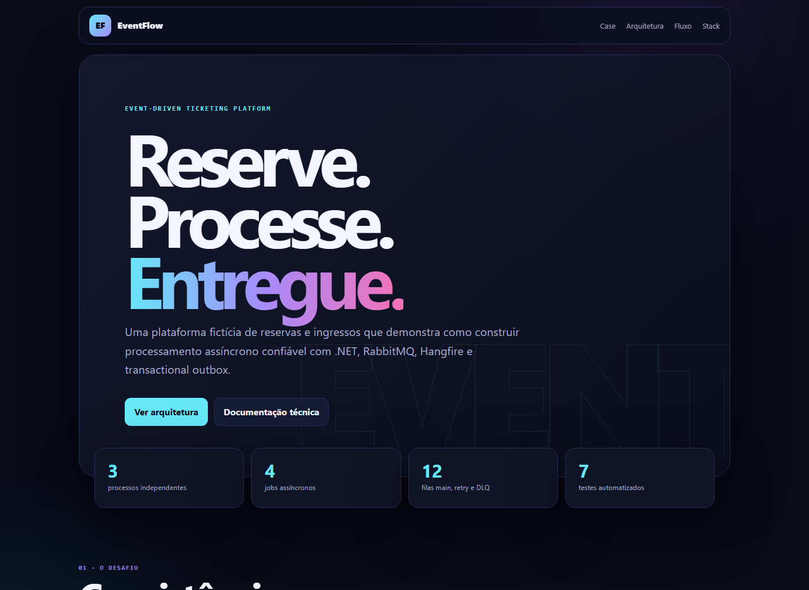
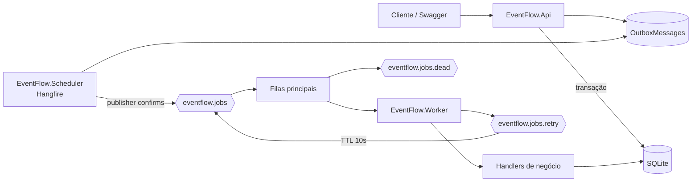

# EventFlow

Plataforma demonstrativa de reservas e emissão de ingressos construída para estudar processamento assíncrono com .NET, RabbitMQ, Hangfire, Worker Services e transactional outbox.

O projeto é totalmente fictício e foi criado do zero para portfólio. Não contém código, nomes, dados, contratos ou infraestrutura de sistemas corporativos.



## O que o projeto demonstra

- API REST documentada com OpenAPI e Swagger UI.
- Domínio com estados e transições protegidas.
- Transactional outbox para não perder mensagens entre banco e broker.
- RabbitMQ com exchanges diretas, mensagens persistentes e publisher confirms.
- Uma fila principal, uma retry e uma dead-letter queue para cada job.
- Worker com consumers assíncronos, ACK manual e prefetch configurável.
- Retry com TTL e limite de tentativas.
- Jobs recorrentes com Hangfire e painel operacional.
- Idempotência por `MessageId` e concorrência otimista.
- SQLite compartilhado entre os processos para uma demonstração simples.
- Testes automatizados do domínio e dos fluxos de aplicação com SQLite.

## Arquitetura



### Processos executáveis

| Processo | Responsabilidade | URL |
|---|---|---|
| `EventFlow.Api` | Eventos, reservas e Swagger | `http://localhost:5080` |
| `EventFlow.Scheduler` | Hangfire, expiração e despacho da outbox | `http://localhost:5081` |
| `EventFlow.Worker` | Consumo das filas e execução dos handlers | Console |

### Jobs

| Job | Regra |
|---|---|
| `ProcessReservation` | Verifica prazo e disponibilidade; confirma ou rejeita a reserva. |
| `GenerateTicket` | Gera um código de ingresso idempotente. |
| `SendNotification` | Simula o envio e registra a conclusão. |
| `ExpireReservation` | Expira reservas pendentes após 15 minutos. |

Cada job declara três filas. Exemplo:

```text
eventflow.process-reservation
eventflow.process-reservation.retry
eventflow.process-reservation.dead
```

No total são 4 filas principais, 4 filas de retry e 4 DLQs.

## Fluxo completo

1. `POST /api/reservations` cria a reserva `Pending`.
2. Na mesma transação, a API grava `ProcessReservation` em `OutboxMessages`.
3. O Scheduler publica a outbox no RabbitMQ e só então marca a mensagem como publicada.
4. O Worker recebe a mensagem sem polling, localiza o handler e reidrata os dados do SQLite.
5. O handler reserva os assentos e cria o próximo job na outbox.
6. O Worker envia ACK somente depois do commit.
7. Uma falha transitória vai para retry; ao esgotar três tentativas, vai para a DLQ.

Uma publicação duplicada pode acontecer se o processo cair depois do publish e antes de atualizar a outbox. Por isso o Worker consulta `JobExecutions` pelo mesmo `MessageId` antes de executar novamente.

## Como executar

Pré-requisitos:

- .NET SDK 10.0.202 ou compatível.
- Docker Desktop para iniciar o RabbitMQ, ou uma instância RabbitMQ local.

Crie o arquivo de ambiente:

```powershell
Copy-Item .env.example .env
```

Suba o broker:

```powershell
docker compose up -d
```

Abra três terminais na raiz do projeto:

```powershell
dotnet run --project src/EventFlow.Api
```

```powershell
dotnet run --project src/EventFlow.Scheduler
```

```powershell
dotnet run --project src/EventFlow.Worker
```

Interfaces:

- Swagger: `http://localhost:5080/swagger`
- OpenAPI para importar no Postman: `http://localhost:5080/openapi/v1.json`
- Hangfire: `http://localhost:5081/hangfire`
- RabbitMQ Management: `http://localhost:15672`

O usuário e a senha presentes em `appsettings.json` são exclusivamente locais e correspondem ao `docker-compose.yml`. Use variáveis de ambiente ou um secrets manager fora do ambiente de demonstração.

## Demonstração rápida

1. Abra o Swagger e execute `GET /api/events`.
2. Copie o `id` do evento demonstrativo.
3. Execute `POST /api/reservations`:

```json
{
  "eventId": "cole-o-guid-do-evento",
  "customerEmail": "portfolio@example.com",
  "quantity": 2
}
```

4. Para não aguardar o próximo minuto do Hangfire, execute `POST http://localhost:5081/jobs/dispatch`.
5. Acompanhe as filas no RabbitMQ e consulte novamente a reserva. O estado evolui de `Pending` até `Notified`.

## Testes e build

```powershell
dotnet build EventFlow.slnx --configuration Release
dotnet test EventFlow.slnx --configuration Release
```

## Estrutura

```text
EventFlow/
├── src/
│   ├── EventFlow.Domain/Entities, Enums
│   ├── EventFlow.Application/
│   │   ├── Abstractions/              # Portas para persistência, mensageria e relógio
│   │   ├── Common, Messaging/
│   │   └── UseCases/
│   │       ├── Events/
│   │       ├── Reservations/
│   │       ├── Jobs/
│   │       └── Outbox/
│   ├── EventFlow.Infrastructure/
│   │   ├── Persistence/             # EF Core e SQLite
│   │   ├── Messaging/               # RabbitMQ
│   │   └── Notifications/
│   ├── EventFlow.Api/Controllers/
│   ├── EventFlow.Scheduler/Controllers/
│   └── EventFlow.Worker/
├── tests/EventFlow.Tests
├── docs/
├── docker-compose.yml
└── EventFlow.slnx
```

Cada pasta em `UseCases` contém `Request`, `Validator`, `Response` e `UseCase`. Os controllers recebem a requisição HTTP e delegam ao caso de uso; os jobs do Worker e do Scheduler seguem o mesmo padrão. O projeto `Application` depende apenas de `Domain`, enquanto `Infrastructure` implementa as interfaces definidas em `Application`. A composição das dependências acontece nos processos executáveis.

## Decisões e limites

- SQLite reduz o custo de execução do case. PostgreSQL ou SQL Server seriam opções naturais em produção.
- O envio de e-mail e o pagamento são simulações; nenhuma transação financeira real é realizada.
- `EnsureCreated` deixa a primeira execução simples. Um sistema produtivo usaria migrations versionadas.
- O dashboard Hangfire aceita apenas acesso local por padrão. Produção exigiria autenticação explícita.
- Métricas, tracing distribuído, health checks do broker e OpenTelemetry fazem parte da evolução sugerida.

## Licença

MIT — consulte [LICENSE](LICENSE).
