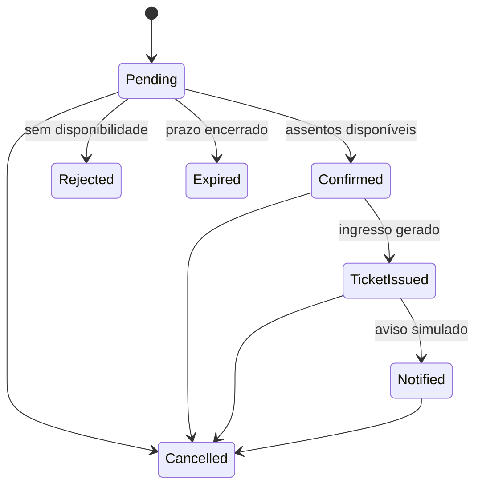

# Decisões arquiteturais

## Camadas e direção das dependências

`EventFlow.Domain` contém entidades, estados e transições. `EventFlow.Application` organiza cada operação em um caso de uso com `Request`, `Validator` e `Response`, além de definir as interfaces necessárias para banco, mensageria, relógio e notificação. `EventFlow.Infrastructure` implementa essas interfaces com EF Core, SQLite e RabbitMQ. API, Scheduler e Worker são pontos de entrada: recebem HTTP, executam jobs ou consomem mensagens e delegam a casos de uso.

```text
Api / Scheduler / Worker → Application → Domain
          │                   ↑
          └→ Infrastructure ──┘
```

O fluxo de uma reserva é `ReservationsController → CreateReservationUseCase → IEventFlowRepository`. A implementação de `IEventFlowRepository` fica em `Infrastructure/Persistence`; assim, a regra de aplicação não precisa conhecer `DbContext` ou controllers. O mesmo limite é usado no despacho da outbox e no processamento dos jobs.

## 1. Separar intenção, transporte e execução

A API registra a intenção de reservar. O Scheduler transporta essa intenção. O Worker executa a regra. Essa divisão impede que indisponibilidade do broker aumente a transação HTTP e evita colocar regra de negócio dentro do scheduler.

## 2. Transactional outbox

`Reservation` e `OutboxMessage` são persistidas na mesma transação. Assim, a API não confirma uma reserva sem deixar registrada a mensagem que precisa ser publicada.

O dispatcher trabalha com entrega pelo menos uma vez. Caso o publish seja confirmado e o processo falhe antes de marcar a outbox, a mesma mensagem pode reaparecer. Os handlers são idempotentes pelo `MessageId`.

## 3. Retry e DLQ

Uma falha transitória é publicada no exchange `eventflow.jobs.retry`. A fila de retry possui TTL de dez segundos e devolve a mensagem ao exchange principal. Depois de três tentativas, o `NACK requeue=false` usa o dead-letter exchange da fila principal.

Se a publicação do retry falhar, o Worker rejeita a entrega original com `requeue=true`, evitando perda silenciosa.

## 4. ACK depois do commit

O ACK só acontece após o handler persistir o estado e o histórico. Se o processo cair antes disso, o RabbitMQ pode reenviar a mensagem e a idempotência impede repetir o efeito.

## 5. Estado pequeno na mensagem

A mensagem carrega identificadores e metadados de rastreamento, não entidades completas. O handler consulta a versão atual da reserva no momento da execução.

```json
{
  "schemaVersion": 1,
  "messageId": "c1cff3f0-4244-4e11-bdcc-50b33912f968",
  "correlationId": "80f3e21d-5d88-4e44-8e67-92058b4a6d51",
  "jobType": "ProcessReservation",
  "reservationId": "9878368c-88fd-4e48-8de6-96b2256387f0",
  "requestedAtUtc": "2030-01-01T12:00:00Z",
  "source": "api",
  "attempt": 0
}
```

## 6. Estados do domínio



## 7. Banco

| Tabela | Finalidade |
|---|---|
| `Events` | Evento, capacidade e assentos disponíveis. |
| `Reservations` | Reserva, estado, prazo, cliente e ingresso. |
| `OutboxMessages` | Mensagens pendentes ou publicadas. |
| `JobExecutions` | Auditoria e idempotência dos consumers. |

As colunas de data são convertidas para `DateTime` UTC no provider SQLite. A API continua expondo `DateTimeOffset`, mantendo o contrato explícito sobre o fuso.
